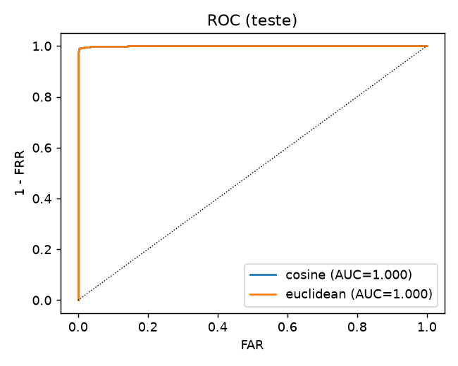
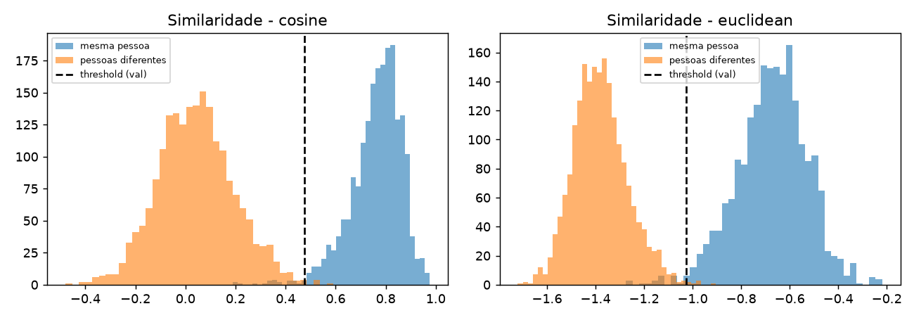
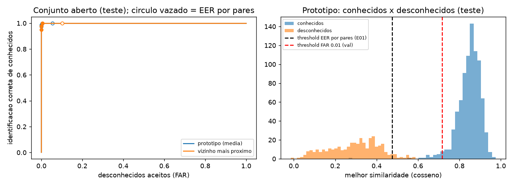
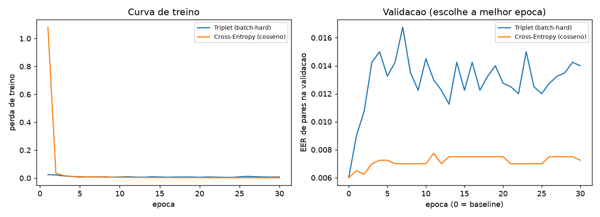
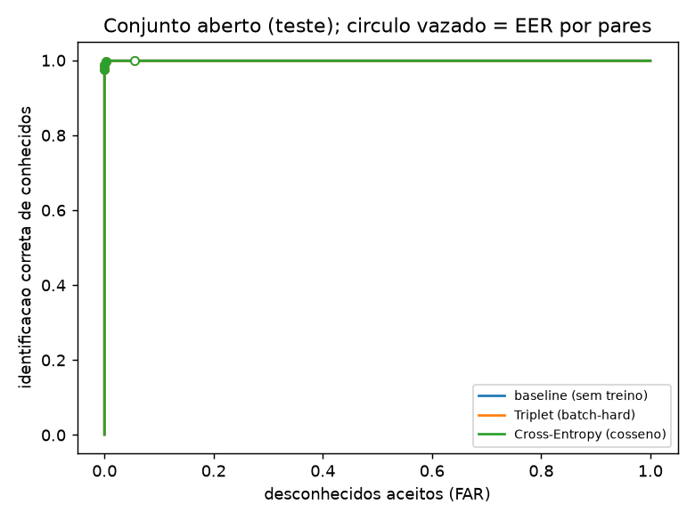

# facerec - Reconhecimento Facial (IA - UFMS)

Trabalho da disciplina de Inteligencia Artificial. Parte 1: experimentacao e fine-tuning.
Parte 2: aplicacao de cadastro e reconhecimento facial.

> Privacidade: este repositorio NAO contem fotos, embeddings, bancos, checkpoints treinados
> com dados privados nem termos de consentimento. Veja `data/README.md` e `.gitignore`.

## Estrutura
```
src/facerec/    codigo-fonte         experiments/    scripts dos experimentos
configs/        configuracoes        tests/          testes automatizados
docs/specs/     especificacoes       docs/decisions/ ADRs
data/README.md  origem dos dados     scripts/        utilitarios (checagem de privacidade)
app/            interface (Streamlit) .streamlit/     config do Streamlit (sem telemetria)
```

## Ambiente
O `facerec-project` foi testado com Python 3.14.7, torch 2.14.1 (CPU) e numpy 2.5.4
(lista completa em `requirements.lock.txt`). O `facenet-pytorch` declara versoes antigas de
torch, numpy e Pillow, entao instalar tudo de uma vez gera conflito de dependencias.
Com ele instalado sem as dependencias, o codigo funciona nas versoes acima:
```
python -m venv .venv && source .venv/bin/activate   # Windows: .venv\Scripts\activate
pip install torch torchvision
pip install facenet-pytorch --no-deps
pip install numpy scipy scikit-learn pandas matplotlib pillow requests tqdm opencv-python pyyaml pytest streamlit
python scripts/check_env.py
pytest
```
Hardware usado nos experimentos: notebook, CPU, 8 GB de RAM, Intel HD Graphics 520 (sem GPU dedicada).

Pre-processamento e transformacoes: recorte central de 144x144 sobre as imagens de 250x250 do
LFW e redimensionamento para 160x160 (valores em `configs/`). As imagens do LFW ja vem com a face
centralizada, entao o carregamento dos experimentos da Parte 1 nao usa detector de faces; a
deteccao entra na aplicacao da Parte 2. Nao ha data augmentation: o FaceNet nao e treinado, e o
E03 treina so uma camada sobre embeddings calculados uma vez e guardados em cache. Seed 42 em
todos os experimentos.

## Datasets
- **Publico (experimentos da Parte 1):** LFW (Labeled Faces in the Wild), na variante
  *funneled* (alinhada), que e a padrao do `fetch_lfw_people`, fonte oficial
  http://vis-www.cs.umass.edu/lfw/, usado para experimentacao e benchmark academico. O
  repositorio nao redistribui o dataset: o codigo usa `fetch_lfw_people` do scikit-learn, que
  baixa uma copia do arquivo hospedada no figshare (o original esta na fonte oficial acima) para
  a pasta de dados do scikit-learn, fora do repositorio. Licenca e detalhes de uso em
  `data/README.md`.
- **Privado (Parte 2):** fotos dos proprios participantes, coletadas com Termo de Consentimento
  e mantidas apenas localmente (`data/private/`, `consent/`). Nada disso vai para o GitHub.

## Decisao da Parte 1
FaceNet (InceptionResnetV1, pesos VGGFace2) **sem treino adicional**, galeria por **prototipo**,
**similaridade de cosseno** e threshold calibrado na validacao com **FAR 1%**.

Justificativa tecnica: o FaceNet pre-treinado gera embeddings de 512 dimensoes que ja separam bem
as pessoas (AUC 0.9995 no E01); roda em CPU, o que e o limite do hardware disponivel; e as duas
tentativas de treino adicional (E03) nao trouxeram ganho. A calibracao do threshold no conjunto
aberto (E02) foi a melhoria que de fato reduziu os erros. Detalhes em `docs/decisions/`.

## Prevenção de data leakage
- A divisão treino/validação/teste é **por identidade** (60/20/20, seed 42): cada pessoa fica em um único conjunto, então fotos parecidas da mesma pessoa não atravessam conjuntos.
- `check_no_leakage` (`src/facerec/splits.py`) levanta erro se uma identidade aparece em dois conjuntos ou se uma imagem idêntica (hash SHA-1 dos bytes) aparece em conjuntos diferentes. A checagem por hash roda no E01 e no E02; no E03 roda só a de identidades, porque os embeddings vêm do mesmo cache.
- O teste só reporta: o threshold, a melhor época do treino e os alvos de FAR são escolhidos na validação (E01, E02 e E03).
- Não há data augmentation, então não existem transformações da mesma imagem espalhadas pelos conjuntos.
- **Limitações:** o hash só detecta imagens idênticas byte a byte; imagens quase idênticas de pessoas diferentes não são verificadas. Além disso, o FaceNet pode ter visto identidades do LFW no pré-treino (VGGFace2), o que a divisão não controla.

## Experimentos (Parte 1)
| Experimento | Modelo | Estratégia | Dataset | Accuracy | F1 | Observação |
|---|---|---|---|---|---|---|
| E01 | FaceNet (VGGFace2) | baseline, cosseno | LFW | 0.9925 | 0.9925 | Accuracy de pares. AUC 0.9995, EER 0.0068; conjunto aberto: 5.48% de desconhecidos aceitos |
| E01 | FaceNet (VGGFace2) | baseline, euclidiana | LFW | 0.9925 | 0.9925 | Idêntico ao cosseno (embeddings normalizados) |
| E02 | FaceNet (VGGFace2) | protótipo, threshold FAR 1% calibrado na validação | LFW | 0.9827 | — | Accuracy do conjunto aberto. Ponto principal (definido a priori). Id. correta 97.54%, desconhecidos aceitos 0% |
| E02 | FaceNet (VGGFace2) | vizinho mais próximo, threshold FAR 1% | LFW | 0.9655 | — | Accuracy do conjunto aberto. Id. correta 95.07%, desconhecidos aceitos 0% |
| E03 | FaceNet (VGGFace2) + camada de projeção 512→512 | Triplet Loss batch-hard, melhor época pela validação | LFW | 0.9925 | 0.9925 | Melhor época = 0 (baseline). O treino piorou o EER na validação |
| E03 | FaceNet (VGGFace2) + camada de projeção 512→512 | Cross-Entropy (classificador por cosseno), melhor época pela validação | LFW | 0.9925 | 0.9925 | Melhor época = 0 (baseline). O treino piorou o EER na validação |

Resultados com dados privados aparecem somente agregados, sem identificar participantes.

## Análise do E01: baseline sem fine-tuning

**Hipótese.** O FaceNet (InceptionResnetV1, pesos VGGFace2) pré-treinado, sem nenhum treino adicional, já gera embeddings que separam bem as pessoas do LFW. Esperávamos EER baixo e resultado parecido entre cosseno e distância euclidiana.

**Configuração.** LFW com identidades de pelo menos 10 fotos: 4324 imagens e 158 identidades. A divisão é por identidade (60/20/20): treino 95 pessoas (2115 imagens), validação 32 (944) e teste 31 (1265). Nenhuma pessoa aparece em dois conjuntos, e a checagem de leakage passou. Embeddings de 512 dimensões, normalizados. Foram usados 4000 pares na validação e 4000 no teste, metade da mesma pessoa. Seed 42, Python 3.14.7, torch 2.14.1 (CPU), notebook com 8 GB de RAM, sem GPU. Extrair os embeddings levou 657 s, uma vez só.

**Resultados.** O threshold foi escolhido na validação (EER 0,60%, threshold 0,4746). No teste:

| Medida | Valor |
|---|---|
| AUC | 0.9995 |
| EER no teste | 0.68% |
| Accuracy / F1 | 0.9925 / 0.9925 |
| FAR / FRR | 0.35% (7 de 2000) / 1.15% (23 de 2000) |





No conjunto aberto (852 fotos de pessoas cadastradas e 365 de desconhecidas), 99.88% dos conhecidos foram identificados corretamente, nenhum foi confundido com outra pessoa, e 5.48% dos desconhecidos (20 de 365) foram aceitos como alguém cadastrado.

**Discussão.**
- **Cosseno e euclidiana deram resultados idênticos.** Os embeddings têm norma 1, então as duas medidas ordenam os pares do mesmo jeito (a distância ao quadrado é 2 − 2·cosseno). Comparar as duas não traz informação nova, e essa comparação só se torna informativa com outros classificadores.
- **O threshold da validação generalizou bem.** O ponto de EER no teste ficaria em 0,4200, mas com o threshold da validação o erro ficou próximo. O sistema ficou um pouco mais rígido que o ideal (FRR maior que FAR).
- **O ponto fraco é a identificação de desconhecidos.** Os 5.48% de desconhecidos aceitos motivaram o E02.

**Limitações.** O FaceNet foi pré-treinado no VGGFace2 e pode haver identidades em comum com o LFW, então o resultado pode estar otimista. O LFW é um benchmark relativamente fácil, e fotos reais de câmera devem render menos. O subconjunto de 158 identidades foi escolhido para caber em CPU e 8 GB de RAM.

## Análise do E02: conjunto aberto

Resultados no conjunto de teste (31 pessoas, metade cadastrada e metade desconhecida). O threshold de cada linha foi escolhido só na validação.

| Galeria | Threshold | Valor | Id. correta | Desconhecidos aceitos | Conhecidos rejeitados | Acurácia do conjunto aberto |
|---|---|---|---|---|---|---|
| Protótipo | EER por pares (E01) | 0.4746 | 99.88% | 5.48% | 0.12% | 98.27% |
| Protótipo | FAR 5% | 0.5823 | 99.77% | 0.27% | 0.23% | 99.75% |
| Protótipo | FAR 2% | 0.6753 | 98.71% | 0.00% | 1.29% | 99.10% |
| Protótipo | FAR 1% (principal) | 0.7160 | 97.54% | 0.00% | 2.46% | 98.27% |
| Vizinho mais próximo | EER por pares (E01) | 0.4746 | 99.88% | 10.14% | 0.12% | 96.88% |
| Vizinho mais próximo | FAR 5% | 0.5978 | 99.88% | 0.55% | 0.12% | 99.75% |
| Vizinho mais próximo | FAR 2% | 0.6962 | 97.77% | 0.00% | 2.23% | 98.44% |
| Vizinho mais próximo | FAR 1% (principal) | 0.7406 | 95.07% | 0.00% | 4.93% | 96.55% |



O gráfico da esquerda mostra a identificação correta contra os desconhecidos aceitos. Os círculos são os thresholds escolhidos na validação e o círculo vazado é o do E01. O da direita mostra a melhor similaridade de conhecidos e desconhecidos, com o threshold do E01 e o de FAR 1%.

**Discussão.** Em verificação de pares o baseline já era muito bom (AUC 0.9995). O ponto fraco aparece na identificação, em que um desconhecido é comparado com todas as pessoas cadastradas e fica com a mais parecida. Isso eleva a similaridade dos impostores, e o threshold de EER por pares deixava passar 5.48% dos desconhecidos. Calibrar o threshold no conjunto aberto da validação reduziu esse erro para 0.27% (FAR 5%) com perda de 0.11 ponto na identificação correta. O vizinho mais próximo aceitou mais desconhecidos no threshold do E01 e identificou pior nos thresholds mais rígidos, mas as diferenças são pequenas e o teste tem poucas pessoas desconhecidas, então não são conclusivas.

**Limitações.** O threshold foi calibrado no LFW e deve ser recalibrado com fotos de câmera real. Os alvos de FAR da validação ficaram conservadores no teste (0% observado), e 0 em 365 fotos não prova FAR zero.

## Análise do E03: camada de projeção sobre embeddings congelados

**Hipóteses.** H1: treinar uma camada 512→512 (iniciada na identidade) sobre os embeddings congelados do FaceNet, só com as identidades de treino, reduz o EER e os desconhecidos aceitos. H2: Triplet Loss supera Cross-Entropy para comparação por similaridade.

**Método.** FaceNet (VGGFace2) congelado; camada linear treinada por 30 épocas (Adam, lr 1e-3, weight decay 1e-4) com Triplet Loss batch-hard (margem 0.3, P=32, K=4) e com Cross-Entropy de classificador por cosseno (escala 16). A melhor época é escolhida pelo EER de pares na **validação**; o teste só reporta. Mesma divisão por identidade, mesmos pares e mesmo conjunto aberto do E01 e do E02.

**Resultado.** Nas duas perdas a melhor época foi a 0, isto é, o próprio baseline. Por isso as três linhas são idênticas.

| Modelo | AUC | EER | Acc | F1 | FAR | FRR |
|---|---|---|---|---|---|---|
| Baseline (sem treino) | 0.9995 | 0.0068 | 0.9925 | 0.9925 | 0.0035 | 0.0115 |
| Triplet (melhor época = 0) | 0.9995 | 0.0068 | 0.9925 | 0.9925 | 0.0035 | 0.0115 |
| Cross-Entropy (melhor época = 0) | 0.9995 | 0.0068 | 0.9925 | 0.9925 | 0.0035 | 0.0115 |



O gráfico acima mostra, por época, a perda de treino e o EER de validação das duas perdas. A época 0 é o baseline.



O gráfico acima mostra, no conjunto aberto do teste, a identificação correta de conhecidos contra os desconhecidos aceitos (FAR). As curvas do baseline, do Triplet e da Cross-Entropy coincidem, porque a melhor época das duas perdas foi a 0, e por isso só a última desenhada (verde) aparece. Os círculos preenchidos são os thresholds calibrados na validação e o círculo vazado é o do EER por pares.

**Análise.**
- **Melhor modelo e por quê.** O baseline. O FaceNet pré-treinado em um dataset grande já separa bem as pessoas do LFW (AUC 0.9995), e treinar com 95 identidades não trouxe ganho.
- **Modificações que pioraram.** As duas camadas treinadas pioraram o EER de validação (de 0.0060 para valores entre 0.0090 e 0.0168 com Triplet, 0.0140 na última época, e entre 0.0062 e 0.0078 com Cross-Entropy, 0.0072 na última). A perda de treino é baixa desde o início (Triplet: 0.024 na época 1 e cerca de 0.008 no fim; Cross-Entropy: de 1.08 na época 1 para 0.035 na época 2 e 0.002 no fim), mas o EER de validação não melhora. É sinal de sobreajuste: a camada tem cerca de 262 mil parâmetros para 95 identidades.
- **H1 e H2.** H1 não se confirma. H2 não pode ser decidida no teste, porque as duas perdas voltaram ao baseline; só dá para dizer que, na validação, a Cross-Entropy piorou menos que a Triplet (uma semente e uma configuração de hiperparâmetros, então sem generalizar).
- **Impacto do fine-tuning.** Nenhum ganho. O que foi treinado é uma camada de projeção sobre embeddings congelados (fine-tuning só da cabeça); as camadas internas do FaceNet não foram ajustadas.
- **Impacto do threshold.** Maior que o do treino adicional. Trocar o threshold de EER por pares (0.4746) pelo calibrado no conjunto aberto com FAR 1% (0.7160) levou os desconhecidos aceitos de 5.48% para 0%, ao custo de rejeitar mais conhecidos (de 0.12% para 2.46%).
- **Erros.** Nenhum conhecido foi confundido com outra pessoa; os erros são conhecidos rejeitados e desconhecidos aceitos.
- **Limitações.** O LFW tem composição desbalanceada e fotos de imprensa; só 31 identidades de teste; uma semente e uma divisão; não foi testado fine-tuning das camadas internas; outros modelos (MobileFaceNet, ResNet pequena) não foram comparados; o dataset privado ainda não foi avaliado.
- **Custo e complexidade.** O custo está em extrair os embeddings (feito uma vez, em CPU, com cache); treinar a camada é leve: o E03 inteiro (30 épocas para cada uma das duas perdas, mais as avaliações) levou 131 s em CPU, com 2 threads. O baseline é o mais simples e o melhor, então é o escolhido.

## Parte 2: aplicação

Aplicação web local (Streamlit) de cadastro e reconhecimento facial. Usa a melhor configuração da Parte 1 sem alterações: detecção MTCNN → embedding FaceNet (VGGFace2, sem treino extra) → galeria por protótipo → similaridade de cosseno → threshold 0.716 (FAR 1% na validação, ver `docs/decisions/ADR-003-recognition-threshold.md`). Nenhuma imagem sai do computador.

### Como rodar
```
.venv\Scripts\activate          # com o ambiente da seção "Ambiente" já instalado
streamlit run app/streamlit_app.py
```
Na primeira execução o Streamlit pergunta um e-mail: basta apertar Enter. O repositório abre com **"Nenhuma pessoa cadastrada"**; quem clonar o projeto cria o próprio banco local em `data/private/`. Os pesos do FaceNet e do MTCNN são baixados na primeira vez.

### Funcionalidades
- **Cadastrar:** nome + 3 a 10 fotos (arquivo ou câmera) + confirmação de que a pessoa é maior de 18 anos e assinou o Termo de Consentimento. Trata nenhuma face, várias faces, imagem inadequada (rosto pequeno, detecção pouco confiável, borrada) e cadastro duplicado. O cadastro é atômico: se algo falha, nada fica salvo.
- **Reconhecer:** imagem de câmera ou arquivo; cada face recebe o nome ou "desconhecida" quando a similaridade fica abaixo do threshold.
- **Pessoas e exclusão:** lista os cadastros e exclui uma pessoa por completo (cadastro, embeddings em cascata e fotos armazenadas).

### Arquitetura
- `src/facerec/detection.py`: detecção, alinhamento e controle de qualidade (spec 001)
- `src/facerec/embedder.py`: FaceNet, mesma padronização da Parte 1
- `src/facerec/store.py`: SQLite local, cascata e `secure_delete` (ADR-002, spec 006)
- `src/facerec/service.py`: casos de uso: cadastro, reconhecimento, exclusão (specs 002 a 004); não depende da interface nem do PyTorch
- `src/facerec/appfactory.py`, `config.py`, `errors.py`: montagem, configuração externa (`configs/app.yaml`) e erros tratados
- `app/streamlit_app.py`: interface (spec 005, ADR-004)

Threshold, parâmetros de qualidade e caminhos ficam em `configs/app.yaml`: mudar o valor muda o comportamento sem alterar código.

### Testes
`pytest` roda os testes da Parte 1 e da Parte 2. Os da aplicação usam detector e embedder de mentira com dados sintéticos (`tests/fakes.py`): não precisam de PyTorch, rede nem fotos reais.

### Privacidade na aplicação
- Banco, fotos (só se `store_photos: true`, desligado por padrão) e logs ficam em `data/private/` e `logs/`, ignorados pelo Git.
- Os logs registram apenas ids curtos e contagens, nunca nomes nem dados biométricos (verificado em teste).
- Estatísticas de uso do Streamlit desativadas (`.streamlit/config.toml`).

### Limitações
O threshold foi calibrado no LFW (fotos de imprensa); com câmera real a distribuição de similaridades pode mudar, então ele deve ser recalibrado com fotos reais de quem for usar (por isso a interface mostra a similaridade). Não há detecção de vivacidade: uma foto de uma foto pode ser aceita. O desempenho com dados privados não foi medido em escala.

## Desenvolvimento
Spec-Driven Development: requisitos e criterios de aceitacao em `docs/specs/`,
decisoes em `docs/decisions/`. Agentes de IA recebem apenas codigo, specs e dados sinteticos
(nunca fotos ou embeddings reais).

## Checagem de privacidade antes de entregar
```
python scripts/check_repo_privacy.py
```